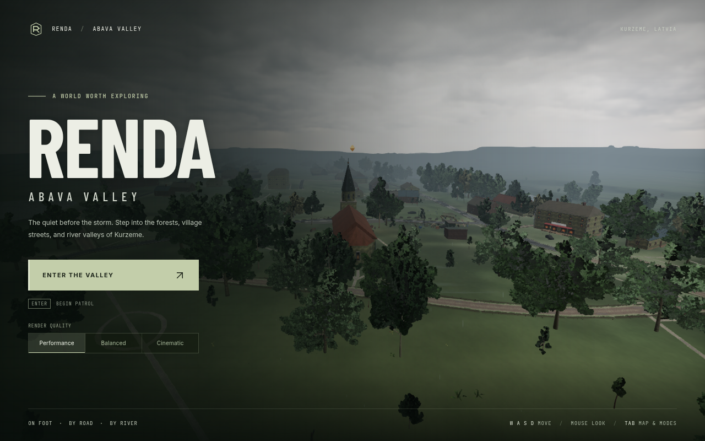

# RENDA · Abava Valley

A browser-based first-person world set in Renda, Latvia, built with Three.js, React and Vite. Includes walking and shooting, driving, canoeing, landmark exploration, and the original architectural studio.

## Run locally

Requires Node.js 22.12+ (Node.js 24 recommended).

```sh
npm ci
npm run dev
```

Open http://localhost:3000. The game and bundled assets work without an API key. The optional AI material/building tools require `GEMINI_API_KEY` in `.env` (copy `.env.example` and fill in your own key).

```sh
npm run lint       # TypeScript
npm test           # World, movement, foliage and weapon math checks
npm run build      # Production client
npm run preview    # Preview the production client
```

For the full server in production, run `npm run build` followed by `NODE_ENV=production npm start`. The static client can also be hosted separately; the optional AI studio needs the server's `/api` routes.

## Visual upgrade

- Photographic outdoor HDR lighting, sky panoramas and reflections, filmic color grading and restrained bloom.
- Cinematic quality adds short-range contact occlusion and 4096-pixel sun shadows. Balanced uses 2048-pixel shadows, while Performance reduces rendering resolution and postprocessing cost.
- Revised water, wet roads, terrain, building weathering and material responses.
- Detailed first-person carbine, sleeves, optic, muzzle flash and smoother weapon motion.
- Pooled surface impacts/dust, a cinematic title menu and a minimal tactical HUD.
- View-aware distant trees, smoother LOD updates, graceful asset-loading fallbacks and a loading screen.

Choose **Performance**, **Balanced**, or **Cinematic** on the title or pause menu. The preference is saved on this browser. Software renderers default to Performance; accelerated devices default to Balanced. For repeatable comparisons, use `?quality=cinematic`, `?quality=balanced`, or `?quality=performance` (the URL overrides the saved preference on reload). `?autostart=1` skips the title.

Cinematic quality costs more GPU time. Browser performance depends on device, viewport and scene density; no desktop-GPU frame-rate claim is implied by the presets. The upgrade keeps the original world and game modes rather than replacing the project with an unrelated demo.

## Denser village and northern European landscape

The second art pass adds a continuous short-grass carpet with a denser 32-blade tier near the player, fuller photographic tree crowns, and eight Latvian tree profiles placed by habitat. The grass base uses CC0 ambientCG Grass004 at its physical scale.

The village approach now includes a detailed field checkpoint, scanned supplies and a covered vehicle, sandbags, fencing, a communications mast, practical floodlights, layered road repairs/gravel/puddles, and atmospheric weather. Fourteen nearby buildings gain facade and roof detail; a maintenance workshop at (195, 59) has an accessible garage, interior, floor and entrance ramp. The first-person carbine, gloves and magazine exchange are also rebuilt.

Choose **Cinematic** for the fullest lighting treatment. On accelerated devices, denser foliage budgets apply automatically. The defaults now open in wet overcast conditions; all five atmosphere options remain available from the tactical map.

See [art direction and future asset approach](docs/ART-DIRECTION.md) for the project's preference for suitable ready-made assets and region-appropriate vegetation.

## Controls

WASD to move; mouse to look after clicking the scene; Shift to sprint; Space to jump; C/Ctrl to crouch; Q/E to lean; left mouse to fire; right mouse/F to aim; R to reload; B to switch fire mode; I to inspect; V to change perspective; Tab for map, travel, weather and modes; Escape to pause. Touch controls are preserved.

See [third-party asset credits](docs/ASSET-LICENSES.md) for the newly sourced CC0 HDRIs and notes on the assets supplied in the original export.

## Preview and verification



See [verification notes](docs/VALIDATION.md) and the actual [Cinematic gameplay](docs/screenshots/cinematic.png), [grass close-up](docs/screenshots/grass.png), and [workshop](docs/screenshots/workshop.png) captures. The screenshots were rendered on the software fallback; they are not promotional reference images.
